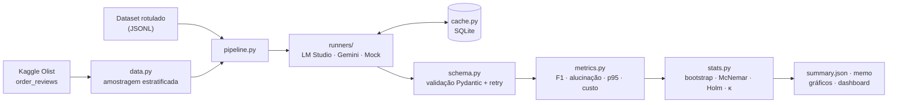
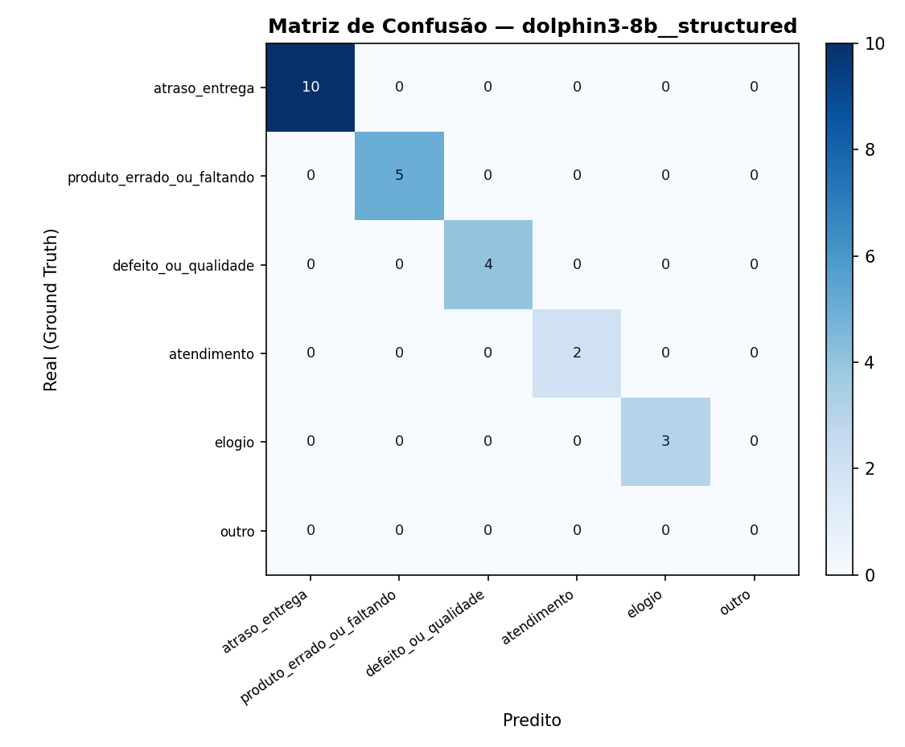
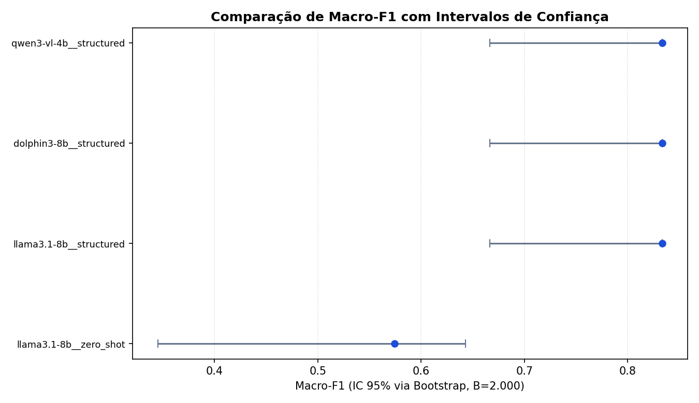
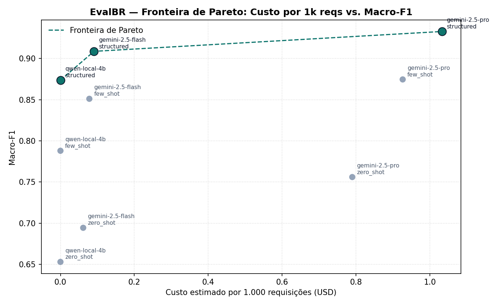

<div align="center">

# EvalBR

**Avaliação estatisticamente rigorosa de LLMs para triagem de reclamações de e-commerce em português**


[](https://github.com/astral-sh/ruff)
[](LICENSE)

</div>

---

## O problema

Uma operação de e-commerce recebe milhares de avaliações em texto livre por dia e precisa encaminhar cada uma para o time certo (logística, qualidade, atendimento). Um LLM pode fazer essa triagem, mas para colocá-lo em produção é preciso responder:

> **Qual modelo e qual estratégia de prompt eu coloco em produção, considerando qualidade, custo e latência, e com quanta confiança estatística eu posso afirmar isso?**

A maioria dos benchmarks de LLM mostra só uma tabela de acurácia. O EvalBR trata cada comparação como um experimento: calcula o tamanho de amostra necessário, reporta intervalos de confiança, testa a significância das diferenças e corrige para comparações múltiplas.

## Destaques

| Camada | O que faz |
|---|---|
| **Contrato de saída** | Schema Pydantic v2 estrito (`extra="forbid"`) com retry automático quando a resposta do modelo não valida |
| **Alucinação determinística** | O modelo precisa citar uma `evidencia` que seja trecho **literal** do comentário. Se o trecho não existir no texto, conta como alucinação, sem depender de outro LLM para julgar |
| **Rigor estatístico** | Análise de poder, IC 95% por bootstrap, teste de McNemar pareado (binomial exato quando há poucos pares discordantes), bootstrap pareado, correção de Holm-Bonferroni e κ de Cohen |
| **Decisão de negócio** | Fronteira de Pareto custo × Macro-F1 e um memo de decisão gerado automaticamente |
| **Engenharia** | Cache SQLite thread-safe por hash de prompt e entrada, execução concorrente, runners plugáveis (LM Studio/OpenAI, Gemini, mock) |
| **Robustez** | Teste com ruído típico de usuário brasileiro (sem acento, "vc", "pq", erros de digitação) |

## Arquitetura



```text
src/evalbr/
├── schema.py         # Contratos Pydantic (ReviewLabel, SystemSpec, EvalRecord)
├── prompts.py        # Templates versionados + injeção de ruído PT-BR
├── cache.py          # Cache SQLite determinístico e thread-safe
├── runners/          # base (retry/validação/custo) · openai_compat · gemini · mock
├── metrics.py        # Qualidade, confiabilidade, alucinação, latência, custo
├── stats.py          # Poder, bootstrap, McNemar, Holm-Bonferroni, κ, Pareto
├── judge.py          # Calibração de LLM-como-juiz contra rótulo humano
├── data.py           # Download do Kaggle, loader estratificado, gerador sintético
├── pipeline.py       # Orquestração, gráficos e memo de decisão
└── cli.py            # evalbr power | demo | run | olist
```

## Resultados

### 1. Avaliações reais da Olist (Kaggle), modelos locais no LM Studio

Amostra estratificada por nota com `n = 20` avaliações reais, sem rótulo humano. Por isso aqui medimos **confiabilidade e concordância entre modelos**, não acurácia. Fonte: [`reports_olist/olist_audit.json`](reports_olist/olist_audit.json).

| Sistema | JSON válido | Retry | Alucinação de evidência | Latência p50 | Latência p95 |
|---|---:|---:|---:|---:|---:|
| `qwen3-vl-4b__structured` | **100%** | **0%** | **0%** | **886 ms** | 1.648 ms |
| `llama3.1-8b__structured` | **100%** | **0%** | **0%** | 1.319 ms | 1.587 ms |
| `dolphin3-8b__structured` | **100%** | **0%** | 25% | 1.337 ms | 3.221 ms |
| `llama3.1-8b__zero_shot` | 70% | 100% | 35% | 3.310 ms | 6.244 ms |

**Concordância entre modelos (κ de Cohen na categoria):** 0,914 a 0,915 entre as três configurações `structured`, contra 0,512 a 0,585 quando comparadas com o `zero_shot`.

**Leitura:** prompt estruturado com exemplos elimina falhas de JSON e retries. A checagem literal de evidência separa modelos que parecem equivalentes: o `dolphin3-8b` concorda com os outros na categoria, mas inventa a citação em 1 de cada 4 casos.

### 2. Benchmark rotulado com modelos reais

Modelos locais reais avaliados em `n = 24` itens de um conjunto **sintético rotulado** em PT-BR (gerado por templates). Fonte: [`reports_real/`](reports_real/).

| Sistema | Acurácia | Macro-F1 (IC 95%) | JSON válido | Alucinação | Latência p50 |
|---|---:|---:|---:|---:|---:|
| `qwen3-vl-4b__structured` | 1,000 | 0,833 [0,667; 0,833] | 100% | 0,0% | 1.055 ms |
| `llama3.1-8b__structured` | 1,000 | 0,833 [0,667; 0,833] | 100% | 0,0% | 1.478 ms |
| `dolphin3-8b__structured` | 1,000 | 0,833 [0,667; 0,833] | 100% | 16,7% | 1.467 ms |
| `llama3.1-8b__zero_shot` | 0,667 | 0,574 [0,345; 0,643] | 66,7% | 33,3% | 3.718 ms |

<p align="center">
  
  
</p>

### 3. Demonstração do pipeline estatístico (simulada)

[`reports/`](reports/) é gerado pelo `MockRunner` (sem chamar nenhum LLM) em `n = 420` itens, para demonstrar Pareto, ICs e testes pareados numa amostra próxima do tamanho indicado pela análise de poder. **Os números desse diretório são simulados e não representam o desempenho real dos modelos citados.**

<p align="center">
  
</p>

## Decisões estatísticas

1. **Por que McNemar e não teste *t*?** Todos os sistemas respondem os mesmos itens (desenho pareado) e o resultado por item é binário (acertou ou errou). McNemar usa só os pares discordantes. Com menos de 25 discordantes, o código troca para o teste binomial exato, porque a aproximação qui-quadrado deixa de ser confiável.
2. **Por que Holm-Bonferroni?** Comparar *k* configurações contra uma referência infla o erro Tipo I. Holm controla a taxa de erro familiar (FWER) com mais poder que Bonferroni simples.
3. **Por que bootstrap para o Macro-F1?** O F1 macro não tem distribuição amostral fechada simples. O bootstrap pareado reamostra itens e preserva a correlação entre os sistemas.
4. **Tamanho de amostra:** para detectar Δ = 5 p.p. com α = 0,05, poder de 80% e cerca de 15% de pares discordantes, o McNemar pareado exige **n ≥ 469**. Um desenho independente exigiria 906 por braço (`evalbr power`).

## Limitações

- Os resultados com modelos reais usam amostras pequenas (n = 20 e n = 24). Os ICs largos refletem isso, e nenhuma diferença entre as configurações `structured` deve ser lida como significativa.
- O benchmark rotulado usa textos sintéticos por template, mais fáceis que comentários reais. O próximo passo é rotular cerca de 470 avaliações reais da Olist seguindo o [guia de anotação](docs/annotation_guide.md) e medir o κ intra-anotador.
- Nos modelos locais o custo é zero, então a fronteira de Pareto só fica informativa ao incluir modelos pagos via API.

## Como rodar

```bash
pip install -e ".[dev]"

evalbr power --discordant-rate 0.15 --delta 0.05     # análise de poder
evalbr demo --samples 420 --output-dir reports       # pipeline completo offline (mock)

# Modelos reais via LM Studio (servidor em http://127.0.0.1:1234)
evalbr run   --config configs/lmstudio_real.json --samples 24 --output-dir reports_real
evalbr olist --config configs/lmstudio_real.json --samples 20 --output-dir reports_olist
# `olist` baixa o dataset via API do Kaggle (requer ~/.kaggle/kaggle.json)

streamlit run app/dashboard.py                       # dashboard interativo
pytest && ruff check src tests                       # testes e lint
```

## Dados e licença

- Código sob licença [MIT](LICENSE).
- As avaliações em `reports_olist/` vêm do [Brazilian E-Commerce Public Dataset by Olist](https://www.kaggle.com/datasets/olistbr/brazilian-ecommerce), licenciado sob **CC BY-NC-SA 4.0**. O uso aqui é não comercial, com atribuição, e esses arquivos derivados seguem a mesma licença.

---

<div align="center">

Feito por **Luiz Santiago** · [GitHub](https://github.com/LuizSantiagojpg)

</div>
